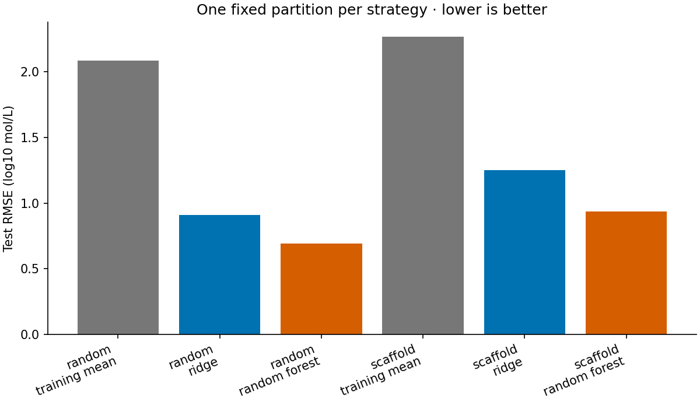
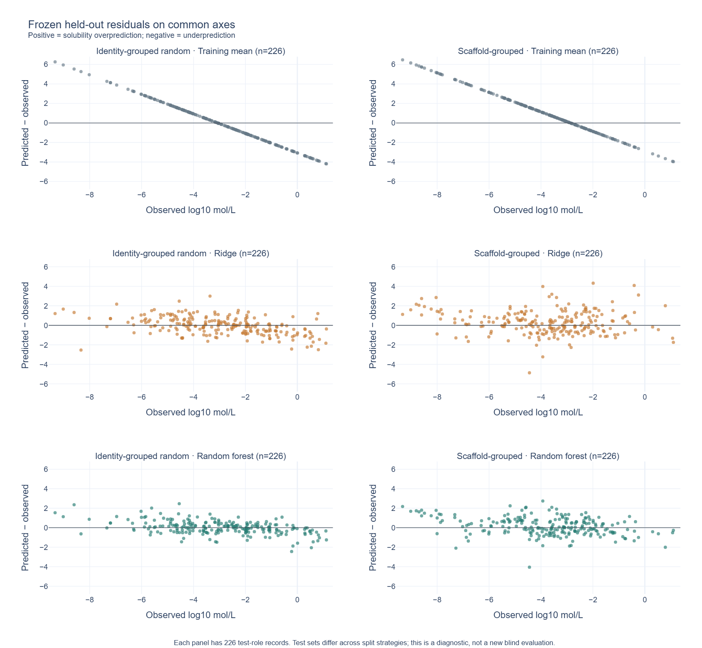
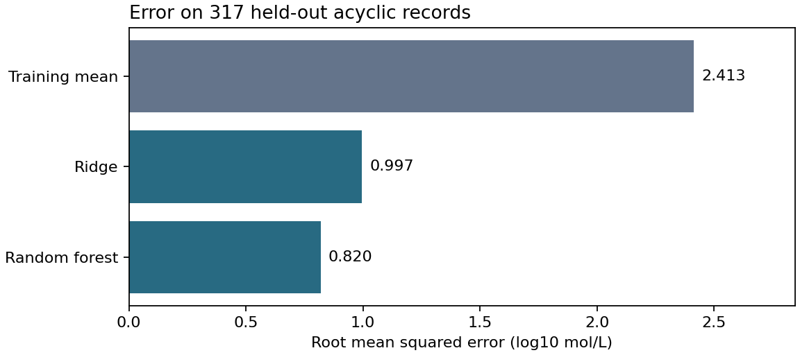

# Molecular solubility benchmark

How well can a model predict how much of a compound dissolves in water when its training set contains different chemical structures? This project compares three models on 1,128 measured solubility records from the Delaney dataset.

## Why this project

Two molecules can have different identities and still share a scaffold, the framework formed by their rings and the links between them. In this dataset, the random forest’s error rose from 0.694 to 0.934 log10 mol/L when the split kept whole scaffolds together. Both the chemistry and the membership of the test set changed. The recorded splits let you trace which measurements contributed to each score. [Project context](docs/project-context.md) · [Chemistry and concepts](docs/biology-and-concepts.md) · [Portfolio guide](https://github.com/TheThunda01/TheThunda01/blob/main/PROJECT_GUIDE.md)

## What it does

- Computes nine explicit RDKit descriptors (numerical structure summaries) from SMILES (Simplified Molecular Input Line Entry System) strings, excluding the source's ESOL prediction and supplied descriptors.
- Keeps repeated canonical structures together in both outer partitions and training-only cross-validation.
- Reports root mean squared error (RMSE), mean absolute error (MAE), the coefficient of determination (R²), structural similarity, and distance-binned errors with group counts.
- Records data provenance, source hashes, software versions, and fixed split fingerprints.
- Audits row-level outer roles and inner validation folds against the recorded reference, offline, without fitting a model or exporting target values.
- Exports **frozen held-out predictions** and verifies their row identities, observed values, and six reconstructed metric rows independently of model fitting.
- Provides an optional Plotly inspector that traces frozen prediction errors to source rows, with a split/model selector and common-axis static panels.

The [audit report](audit/report.md) and [practical-use guide](docs/practical-use.md) explain how to reuse these partitions in another notebook.

## Quick start

Python 3.12 was used for the recorded run. From this folder:

```sh
python -m venv .venv
```

Activate it with `source .venv/bin/activate` on macOS/Linux, or `.venv\Scripts\Activate.ps1` in PowerShell. Then:

```sh
python -m pip install -r requirements.txt
python -m unittest discover -s tests -v
python -m solubility_benchmark --output reproduced-results/analysis
python -m solubility_benchmark.audit --output reproduced-results/audit
python -m solubility_benchmark.predictions verify examples/heldout-predictions
```

The attributed two-column data subset is included, so these commands work offline after installation. The analysis and audit write separate directories under `reproduced-results/`, preserving the recorded `results/` and `audit/`. The audit compares assignments with the original `results/split_manifest.json`; it does not compare model scores.

To create a fresh prediction bundle, run `python -m solubility_benchmark.predictions export --output predictions-001`, then verify it with `python -m solubility_benchmark.predictions verify predictions-001`. The destination must not exist. Export refits the recorded configurations on their training partitions; verification does not fit anything. Neither command replaces the recorded results.

The optional `python scripts/rebuild_dataset.py` downloads and verifies the original pinned sources before recreating the subset. For a full numerical reproduction check that leaves the recorded results in place, run `python scripts/check_reproduction.py`.

## Example results

All three models had higher RMSE under the scaffold-grouped partition. Lower RMSE indicates smaller prediction errors.

| Partition | Mean-baseline RMSE | Ridge RMSE | Random-forest RMSE |
| --- | ---: | ---: | ---: |
| Identity-grouped random | 2.088 | 0.911 | 0.694 |
| Scaffold-grouped | 2.266 | 1.250 | 0.934 |

Errors are in **log10 molar-solubility units**. Both partitions contain 902 training and 226 test records. Their test sets differ, so the gap combines structural separation and test-set composition; it is not a controlled causal estimate of scaffold overlap.



The mean-only baseline also has higher error on the scaffold test set (2.266 versus 2.088). It uses no structure descriptors, which helps illustrate how the change in test records affects this comparison. [Metric rows](results/metrics.csv) · [Split assignments](audit/report.md)

The audit exports **2,256 assignment rows**, one per source record under each strategy. Canonical-identity overlap across train/test is zero under both rules. Scaffold overlap is zero under the scaffold rule; the random rule reports its overlap. These checks describe the supplied group definitions, not every possible chemical relationship.

The [prediction example](examples/heldout-predictions/README.md) contains **1,356 test-role rows**: 226 for each of six split/model pairs. Its observed values and predictions reconstruct the existing RMSE, MAE, and R² at the recorded tolerance. This is a reproducibility result, not a new performance experiment.



A residual above zero means the model predicts greater solubility than measured. For example, the random split’s mean-only model predicts −3.069 for source data row 19, whose measured value is −3.640. Its residual is approximately +0.571 log10 mol/L. Each panel contains 226 test records, with 405 distinct records across the two splits. [Frozen prediction rows](examples/heldout-predictions/predictions.csv) · [Interactive inspection guide](docs/prediction-inspection.md) · [Vector figure](docs/figures/frozen-residuals.svg)

See the [generated analysis](results/report.md), [structural similarity](results/structural_similarity.csv), and [distance/error summaries](results/distance_error_bins.csv). Different scaffold keys can still represent similar chemistry; distance bins are diagnostics, not calibrated reliability limits.

### How well do models trained on ring structures predict acyclic solubility?

The original scaffold split placed all 317 acyclic records in training because they share the empty Murcko scaffold. A separate sensitivity analysis holds out that entire group and trains on the 811 remaining records. Model settings are selected by cross-validation within the 268 training scaffolds. The two partitions share zero canonical identities.



The forest's RMSE was **0.820 log10 mol/L** on this specific group. The original scaffold test covers different records. Each score therefore answers a different transfer question. The acyclic group pools chemically diverse compounds under one structural convention.

Run `python -m solubility_benchmark.acyclic_holdout --output reproduced-results/acyclic` to recreate the chart and [scores, split fingerprints and selected settings](examples/acyclic-holdout/scores.json). All selection uses the training partition. This sensitivity analysis was added after inspection of the original benchmark.

## Practical use and limitations

Use the benchmark to check reproducibility or examine how partition choices affect a modeling claim. Model selection uses grouped cross-validation (CV), keeping specified related records together within training data. The audit exposes those assignments without using held-out targets to choose partitions.

Prediction rows expose observed outcomes so their metrics can be checked. A record held out in one strategy can be training data in the other; the combined export is not a label-blind training resource. Keep these outcomes out of new model choices if you intend to continue treating the same rows as held out. The exporter uses the recorded parameters without a new search, and refuses changed source fingerprints, incompatible runtime versions, or an existing destination.

One fixed partition per strategy supplies no confidence interval or external validation. The benchmark leaves missing experimental pH, temperature, assay method, and solid-form information unresolved. It defines chemical identity through the specified RDKit conventions, without salt stripping, neutralization, or tautomer standardization. A passing audit verifies recorded computational choices; it does not validate measurements, predictions, therapeutic value, or performance on new chemistry.

The [practical-use guide](docs/practical-use.md) separates implemented checks from operator responsibilities and future work. The [bounded literature review](docs/literature-review.md) records how the evidence informed this update.

## Documentation

| Start here | Purpose |
| --- | --- |
| [Project context](docs/project-context.md) | Background, motivation, and main themes. |
| [Biology and chemistry concepts](docs/biology-and-concepts.md) | What solubility, descriptors, and evaluation metrics represent. |
| [Methods and limitations](docs/methods.md) | Split rules, acyclic handling, model grids, and interpretive limits. |
| [Glossary](docs/glossary.md) and [assumptions](docs/assumptions.md) | Vocabulary, design rationales, checks and failure consequences. |
| [Reference audit](docs/reference-audit.json) and [review record](docs/review-2026-10-20.md) | Source verification and corrections. |
| [Maintenance review, 21 October 2026](docs/review-2026-10-21.md) | Source checks, Windows test support and fresh reproduction. |
| [References](docs/references.md) | Source attribution and the claims each source supports. |
| [Data provenance](docs/data-provenance.md) and [reuse terms](data/LICENSE.md) | Source chain, row counts, hashes, and licensing. |
| [Data dictionary](docs/data-dictionary.md) | Inputs, descriptors, and output meanings. |
| [Practical use](docs/practical-use.md) | Worked audit use, checks, and prioritized improvements. |
| [Literature review](docs/literature-review.md), [original search log](docs/search-log.json), and [round 2 update](docs/search-update-02.json) | Scope-specific searches, screening, and source-to-code decisions. |
| [Verification](docs/verification.md) | Executed checks and reproduction record. |
| [Prediction inspection](docs/prediction-inspection.md) | Optional Plotly view, source-row hover, residual convention, and reproduction. |

## Development and reuse

The original tests check input validation, target leakage, split separation, scaling, metrics, and undefined R². Audit tests check exported membership, reference mismatches, deterministic output, and input protection. Prediction tests check exact held-out membership, source-row mapping, independent arithmetic, corrupted bundles, and refitting without parameter search. The broken-symlink check is separate and reports a skip when the operating system cannot create a symlink; the other output-protection checks still run. CI runs the suite on Ubuntu and Windows. Run the tests and numerical reproduction check before contributing; see [CONTRIBUTING.md](CONTRIBUTING.md).

The measurements originate from [Delaney's 2004 supporting data](https://doi.org/10.1021/ci034243x.s001), distributed as a processed benchmark by DeepChem. The original development sample, released supporting table, and common benchmark have different row counts, explained in [provenance](docs/data-provenance.md).

**Software: MIT. Data adaptation: CC BY-NC 4.0.** The software license does not override the data's noncommercial condition. Read [data attribution and reuse](data/LICENSE.md) before redistributing or using the measurements. No endorsement by the source authors, ACS, DeepChem, or RDKit is implied.
