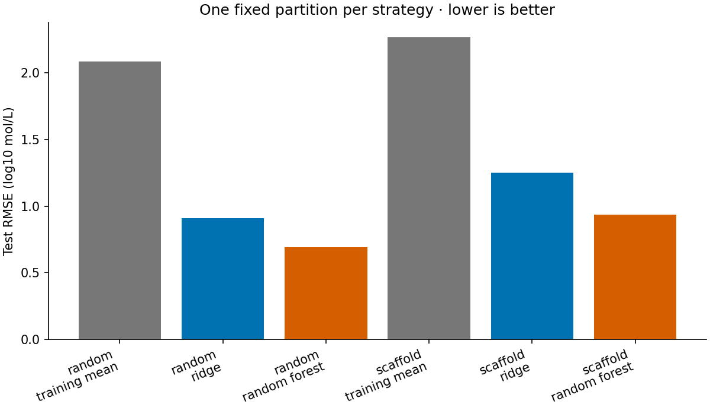

# Molecular solubility benchmark

**How much does a chemical-property model's evaluation change when related structures are kept together?**

This project follows that question through a small retrospective benchmark, with readable results and a split audit that makes the evaluation plan easier to inspect and reuse.

## Why this project

A prediction score is only useful when its data and evaluation choices are clear. This project uses 1,128 public measured-solubility records to compare a mean baseline, ridge regression, and a random forest. It contrasts an identity-grouped random split with a scaffold-grouped split, then examines held-out errors by distance from training descriptors.

The goal is to understand evaluation choices, not to design molecules or support clinical decisions. Start with the [project context](docs/project-context.md) or the [chemistry and concepts](docs/biology-and-concepts.md).

## What it does

- Computes nine explicit RDKit descriptors (numerical structure summaries) from SMILES (Simplified Molecular Input Line Entry System) strings, excluding the source's ESOL prediction and supplied descriptors.
- Keeps repeated canonical structures together in both outer partitions and training-only cross-validation.
- Reports root mean squared error (RMSE), mean absolute error (MAE), the coefficient of determination (R²), structural similarity, and distance-binned errors with group counts.
- Records data provenance, source hashes, software versions, and fixed split fingerprints.
- Adds an offline **split audit**: row-level outer roles and inner validation folds, checked against the recorded reference without fitting a model or exporting target values.
- Exports **frozen held-out predictions** and verifies their row identities, observed values, and six reconstructed metric rows independently of model fitting.

The new [audit report](audit/report.md) and [practical-use guide](docs/practical-use.md) explain how to carry the same partitions into another notebook.

## Quick start

Python 3.12 was used for the recorded run. From this folder:

```sh
python -m venv .venv
```

Activate it with `source .venv/bin/activate` on macOS/Linux, or `.venv\Scripts\Activate.ps1` in PowerShell. Then:

```sh
python -m pip install -r requirements.txt
python -m unittest discover -s tests -v
python -m solubility_benchmark --output reproduced-results/analysis
python -m solubility_benchmark.audit --output reproduced-results/audit
python -m solubility_benchmark.predictions verify examples/heldout-predictions
```

The attributed two-column data subset is included, so these commands work offline after installation. The analysis and audit write separate directories under `reproduced-results/`, preserving the recorded `results/` and `audit/`. The audit compares assignments with the original `results/split_manifest.json`; it does not compare model scores. To create a fresh prediction bundle, run `python -m solubility_benchmark.predictions export --output predictions-001`, then verify it with `python -m solubility_benchmark.predictions verify predictions-001`. The destination must not exist. Export refits the already-recorded configurations on their training partitions; verification does not fit anything. Neither command replaces the recorded results.

The optional `python scripts/rebuild_dataset.py` downloads and verifies the original pinned sources before recreating the subset. For a full numerical reproduction check that leaves the recorded results in place, run `python scripts/check_reproduction.py`.

## Example results

| Partition | Mean-baseline RMSE | Ridge RMSE | Random-forest RMSE |
| --- | ---: | ---: | ---: |
| Identity-grouped random | 2.088 | 0.911 | 0.694 |
| Scaffold-grouped | 2.266 | 1.250 | 0.934 |

Errors are in **log10 molar-solubility units**. Both partitions contain 902 training and 226 test records. Their test sets differ, so the gap combines structural separation and test-set composition; it is not a controlled causal estimate of scaffold overlap.



The audit exports **2,256 assignment rows**, one per source record under each strategy. Canonical-identity overlap across train/test is zero under both rules. Scaffold overlap is zero under the scaffold rule; the random rule reports its overlap. These checks describe the supplied group definitions, not every possible chemical relationship.

The [prediction example](examples/heldout-predictions/README.md) contains **1,356 test-role rows**: 226 for each of six split/model pairs. Its observed values and predictions reconstruct the existing RMSE, MAE, and R² at the recorded tolerance. This is a reproducibility result, not a new performance experiment.

See the [generated analysis](results/report.md), [structural similarity](results/structural_similarity.csv), and [distance/error summaries](results/distance_error_bins.csv). Different scaffold keys can still represent similar chemistry; distance bins are diagnostics, not calibrated reliability limits.

## Practical use and limitations

Use the benchmark for reproducibility work or to inspect how a modeling claim depends on its partition. All model selection uses grouped cross-validation (CV), which keeps specified related records together within training data, and the audit exposes those assignments without using held-out targets for partition decisions.

Prediction rows expose observed outcomes so their metrics can be checked. A record held out in one strategy can be training data in the other; the combined export is not a label-blind training resource. Keep these outcomes out of new model choices if you intend to continue treating the same rows as held out. The exporter uses the recorded parameters without a new search, and refuses changed source fingerprints, incompatible runtime versions, or an existing destination.

One fixed partition per strategy supplies no confidence interval or external validation. Missing experimental pH, temperature, assay method, and solid-form information are not filled with assumptions. Chemical identity uses the specified RDKit conventions, without salt stripping, neutralization, or tautomer standardization. A passing audit verifies recorded computational choices; it does not validate measurements, predictions, therapeutic value, or performance on new chemistry.

The [practical-use guide](docs/practical-use.md) separates implemented checks from operator responsibilities and future work. The [bounded literature review](docs/literature-review.md) records how the evidence informed this update.

## Documentation

| Start here | Purpose |
| --- | --- |
| [Project context](docs/project-context.md) | Background, motivation, and main themes. |
| [Biology and chemistry concepts](docs/biology-and-concepts.md) | What solubility, descriptors, and evaluation metrics represent. |
| [Methods and limitations](docs/methods.md) | Split rules, acyclic handling, model grids, and interpretive limits. |
| [Glossary](docs/glossary.md) and [assumptions](docs/assumptions.md) | Vocabulary, design rationales, checks and failure consequences. |
| [Reference audit](docs/reference-audit.json) and [review record](docs/review-2026-10-20.md) | Source verification and corrections. |
| [Maintenance review, 21 October 2026](docs/review-2026-10-21.md) | Source checks, Windows test support and fresh reproduction. |
| [References](docs/references.md) | Source attribution and the claims each source supports. |
| [Data provenance](docs/data-provenance.md) and [reuse terms](data/LICENSE.md) | Source chain, row counts, hashes, and licensing. |
| [Data dictionary](docs/data-dictionary.md) | Inputs, descriptors, and output meanings. |
| [Practical use](docs/practical-use.md) | Worked audit use, checks, and prioritized improvements. |
| [Literature review](docs/literature-review.md), [original search log](docs/search-log.json), and [round 2 update](docs/search-update-02.json) | Scope-specific searches, screening, and source-to-code decisions. |
| [Verification](docs/verification.md) | Executed checks and reproduction record. |

## Development and reuse

The original tests check input validation, target leakage, split separation, scaling, metrics, and undefined R². Audit tests check exported membership, reference mismatches, deterministic output, and input protection. Prediction tests check exact held-out membership, source-row mapping, independent arithmetic, corrupted bundles, and refitting without parameter search. The broken-symlink check is separate and reports a skip when the operating system cannot create a symlink; the other output-protection checks still run. CI runs the suite on Ubuntu and Windows. Run the tests and numerical reproduction check before contributing; see [CONTRIBUTING.md](CONTRIBUTING.md).

The measurements originate from [Delaney's 2004 supporting data](https://doi.org/10.1021/ci034243x.s001), distributed as a processed benchmark by DeepChem. The original development sample, released supporting table, and common benchmark have different row counts, explained in [provenance](docs/data-provenance.md).

**Software: MIT. Data adaptation: CC BY-NC 4.0.** The software license does not override the data's noncommercial condition. Read [data attribution and reuse](data/LICENSE.md) before redistributing or using the measurements. No endorsement by the source authors, ACS, DeepChem, or RDKit is implied.
