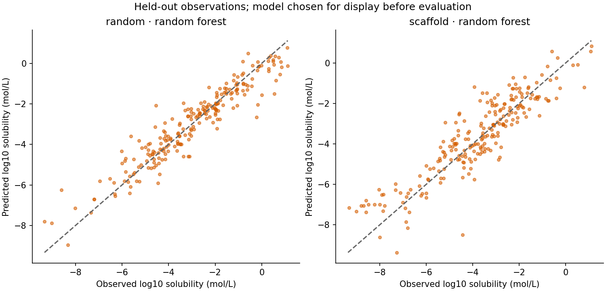
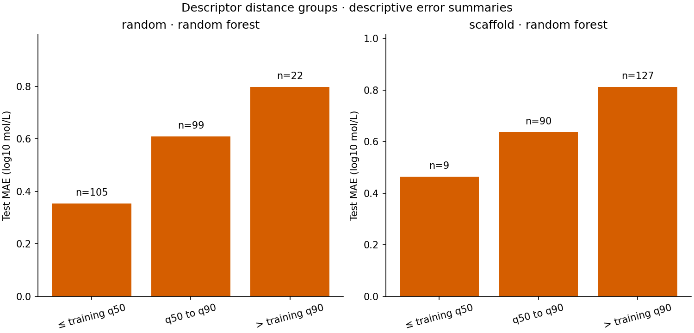

# Measured aqueous-solubility benchmark

Target: log10 of measured solubility in mol/L. Lower error is better. These are retrospective results for two different fixed test partitions, not a causal estimate of the effect of scaffold overlap.

| Partition | Model | Test records | RMSE (log10 mol/L) | MAE (log10 mol/L) | R² |
| --- | --- | ---: | ---: | ---: | ---: |
| random | training_mean | 226 | 2.088 | 1.691 | -0.002 |
| random | ridge | 226 | 0.911 | 0.714 | 0.809 |
| random | random_forest | 226 | 0.694 | 0.508 | 0.889 |
| scaffold | training_mean | 226 | 2.266 | 1.710 | -0.202 |
| scaffold | ridge | 226 | 1.250 | 0.950 | 0.634 |
| scaffold | random_forest | 226 | 0.934 | 0.729 | 0.796 |

## Distance is a diagnostic, not a certificate

Nearest-training distances use nine standardized descriptors. Scaling and distance-bin cutoffs use training data only. Wider-distance bins can reveal error patterns, but they are not calibrated uncertainty intervals or validated applicability-domain limits. Small bins are unstable; counts are shown.

Different scaffold labels do not ensure low chemical similarity. See [structural similarity](structural_similarity.csv) for nearest-training Morgan-fingerprint similarities, and [methods](../docs/methods.md) for the acyclic-group rule and selection limits.

No molecule is proposed, optimized, ranked for therapeutic use, or given a safety/efficacy recommendation.
